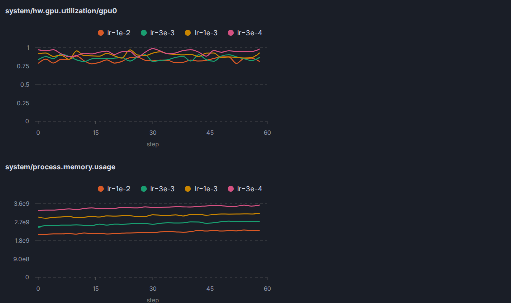
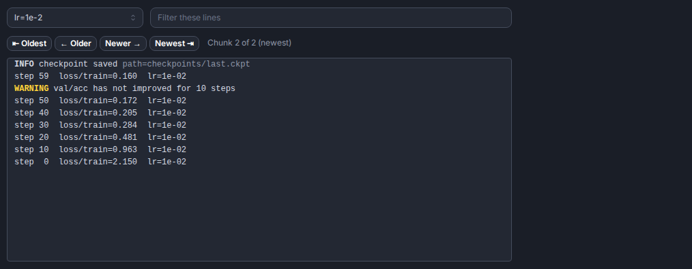

# Client & logging

## What is this

`dlboard.client.run` (`dlboard/client/run.py`) logs a run from any training loop: plain PyTorch, the HF `Trainer`,
JAX, anything. `dlboard.client.dlboard_logger.DLBoardLogger` is the same thing as a `pytorch_lightning.loggers.Logger`,
to drop into a `Trainer` like any other PL logger. Either talks to a running dlboard server over REST via
`BasicDlboardAPI` (`dlboard/client/_rest_api.py`), and spawns two daemon subprocesses that batch metrics and artifacts
off multiprocessing queues and flush them on an interval, so training is never blocked on network I/O.

## When you'd need this

Every training script that wants runs to show up in dlboard uses this. This page is also where to
look if you want to log a new *kind* of artifact (images are the only built-in kind today) — see
below.

## How it works

```python
from dlboard.client import run as dlboard

if __name__ == "__main__":
    with dlboard.init("my-project", hparams=config, server_url="http://localhost:8050") as run:
        for step, batch in enumerate(loader):
            run.log_metrics({"train/loss": train_step(batch)}, step=step)
```

`init(project, experiment="default", ...)` creates the project and experiment by name the first time it sees them and
starts a run in them (`name=` names it; one is made up otherwise). It needs only the base `dlboard-client` install,
not Lightning or torch. Every metric needs its `step`: dlboard keeps no counter of its own, which another process
sharing the run or a resumed run couldn't agree with. The `with` block finishes the run as *finished*, or as *failed* if
it raises; without one, call `run.finish()` (or `run.finish(RunStatus.FAILED)`). `examples/plain_quickstart.py` is a
complete, runnable example.

With PyTorch Lightning, the logger does the same:

```python
from dlboard.client.dlboard_logger import DLBoardLogger

logger = DLBoardLogger.from_names("my-project", server_url="http://localhost:8050")
trainer = pl.Trainer(logger=logger)
```

`DLBoardLogger(project_id=..., experiment_id=...)` takes ids instead; omit `experiment_id` and one is created for you.
Metrics logged via PL's normal `self.log(...)` and hyperparameters via `save_hyperparameters()` are picked up
automatically. See `examples/lightning_quickstart.py` for a complete, runnable example (MNIST MLP, with a matplotlib
figure), `examples/lightning_advanced.py` for a tour of the rest (nested hyperparameters, checkpoints, mask and box
previews, interactive Plotly figures, Lightning's monitoring callbacks), and `examples/lightning_stress_test.py`, the
same run logging far more, to load a server rather than to be looked at.

Everything below is the same for both: `logger.log_artifact(...)`, `logger.log_histograms(...)` and the rest are a
run's `run.log_artifact(...)`, `run.log_histograms(...)`, ..., and `logger.finalize(...)` is `run.finish(...)`.

**Hyperparameters.** `init(hparams=...)`, `save_hyperparameters()` (or `logger.log_hyperparams(...)`) takes anything
nested: pydantic models, pydantic and stdlib dataclasses, a `Namespace`, plain dicts and ordinary
init args. They're flattened to `parent/child` keys (`optim/schedule/warmup_steps`), which the
experiment page's hyperparameter columns and run compare group on the same `/`. Pydantic serializes
them, so a model's aliases and field serializers apply; a list is stored as one JSON string, and
scalars are stored exactly as given.

**Checkpoints.** `DLBoardLogger(..., log_model="all")` uploads every checkpoint a `ModelCheckpoint`
saves, even one `save_top_k` deletes moments later (each is copied before it's queued). `log_model=True`
uploads only the ones still kept, when training finishes. Each is a `File` (below) of kind `checkpoint`,
keyed `checkpoints/<file name>`, tagged with its score and Lightning's `latest`/`best`/`best_k`, and
stamped with the global step its callback saved at (with `log_model=True`, the step of that callback's last
save). Any number of `ModelCheckpoint` callbacks work. On the experiment page they are one list, split into
`Latest`, `Best` and `Top-k` tabs by those tags, paged and sortable by step and score.

**What produced a run.** A new run records, as it starts, what produced it: the git commit, branch and
`origin` remote (credentials taken out of its URL) and whether tracked files had changes, the command line, working
directory and interpreter, the Python version, platform and host, every installed distribution's version, and -- when
the script already imported torch -- the CUDA version it was built with (and the GPUs' names, once the script has
started CUDA itself: dlboard never starts it). With `DLBOARD_CONTEXT_DIFF=true` (off by default, since uncommitted changes
are where a secret pasted in to try something sits) the changes not yet committed (`git diff HEAD`) are uploaded as the
run's `context/git.diff` artifact, unless the diff is over 1 MB. On the experiment page, auto-generate gives it a
`run_context` chart in a *Run context* panel (or add one from Suggest charts): a fact a row and a run a column, its
sections and "only differences" chosen in its settings, with each run's `git.diff` linked under it. The run compare
(**Diff**) lists all of it as *Context*, beside the hyperparameters, so "Differences" shows the commit, the command or
the package versions two runs did not share. Nothing about it fails or holds up a run: what can't be found (no git, a
notebook) is left out, and a server older than this answers with a warning. Turn parts off with `DLBOARD_CONTEXT_GIT`,
`DLBOARD_CONTEXT_COMMAND` (if your arguments carry secrets) and `DLBOARD_CONTEXT_PACKAGES`, or
`RunSettings(context=ContextSettings(...))`. Environment variables are never recorded. A run attached to (`run_id=`)
keeps the context it was started with.

**Pinning, keeping and tagging a run.** A script that knows its run matters can say so as it launches it, instead of
someone clicking afterwards: `DLBoardLogger(..., pin=PinColor.RED)` pins the run for you in that colour (see
[comparisons.md](comparisons.md#pins)), `keep=True` keeps it out of [retention](retention.md)'s reach, and
`tags=["baseline", "sweep-3"]` tags it (see [comparisons.md](comparisons.md#tags)). All three are also arguments of
`DLBoardLogger.from_names` and `dlboard.init`. Pinning is for anyone who can see the run; keeping and tagging take an
editor of its project. A server that refuses fails the logger's construction, with its reason in the error, before anything
is logged; `BasicDlboardAPI.mark_run(run_id, pin=..., keep=..., tags=...)` does the same to a run that exists.

**Authenticating.** If the server signs people in (see [Auth](plugins/auth.md)), the script has to
sign in too:

- Create an API token on your Account page.
- Set it as `DLBOARD_API_KEY` wherever the script runs, or pass `api_key=` to `BasicDlboardAPI`.

Before it starts, the logger checks the key with the server's `/api/v1/whoami` and fails right away if
it's missing or wrong. Without that check, bad credentials would only show up later, as metrics
that were never stored. `dlboard serve local` needs no key.

**A job on a cluster: a run token.** A job that runs somewhere else (a SLURM or Kubernetes job, a shared
cluster's vault) shouldn't carry your API token, which can do anything you can. Mint a *run token* where
you submit the job instead, and hand the job that:

```bash
DLBOARD_API_KEY=$(dlboard run-token --project vision --experiment sweep) sbatch train.sh
```

`dlboard run-token` starts a run (or takes `--run-id`'s) with your own token, and prints a `dlr_...` token
that logs to that run alone. The job's `dlboard.init(...)` or `DLBoardLogger` then logs to that run,
whatever project and experiment the script names. It needs no `run_id` and looks nothing up by name. The
token reaches only what a run's own client calls: logging metrics, hyperparameters and artifacts, and
marking and finishing the run. It can't read anything back, see or log to another run, make a project, or
mint more tokens. It expires a week after it is minted (`DLBOARD_RUN_TOKEN_LIFETIME_HOURS`), and minting
one takes an editor of the run's project.

From Python (a Bazel rule, a launcher, a notebook that submits jobs), `dlboard.client.run.run_token` does the same:

```python
from dlboard.client.run import run_token

# Asked with your own key, from DLBOARD_API_KEY; the job gets only the run token.
minted = run_token("vision", "sweep", name="lr-3e-4", server_url="https://dlboard.example")
env = {**job_env, "DLBOARD_API_KEY": minted.token}  # and minted.run_id, minted.expires_at
```

`run_id=` mints one for a run that exists instead, and `api_key=` asks with a key other than `DLBOARD_API_KEY`.

**Guard your script's entry point.** The two shipping processes are started with `multiprocessing`'s
`spawn` method, which re-imports your training script's `__main__` module from scratch in each one.
A script that builds the logger (or starts training) at module level, with no
`if __name__ == "__main__":` guard, re-runs that code in every shipping process too — usually
visible as training appearing to restart, or the logger itself being constructed more than once.
This is the same requirement Python's own `multiprocessing` docs describe for any spawn-based code,
not something specific to dlboard.

**System metrics.** Install `dlboard-client[system]` and a run samples the host's CPU and
memory and the training process's own, every 30 seconds; add `dlboard-client[gpu]` (NVML, NVIDIA's management library)
and it samples each GPU the run can use too (`CUDA_VISIBLE_DEVICES`, as CUDA numbers them: `gpu0` is `cuda:0`):
utilization, memory, temperature and power. They are two extras because NVML is missing or unusable on plenty of
machines that still have a CPU worth watching: either works without the other, and NVML that can't start only turns
the GPU part off. Each sample is ordinary metrics under `system/` (`system/cpu.utilization`,
`system/hw.gpu.memory.usage/gpu0`, ... named after OpenTelemetry's semantic conventions), at a step that is the Unix
time it was taken, so a resumed run's samples never land on its earlier ones; auto-generate charts them in a `system`
panel against the time they were logged. They are read through OpenTelemetry instruments on a meter provider of the
run's own: it is never made the global one, and nothing is exported anywhere but to the dlboard server. Sampling runs on
a thread of its own in the training process (process metrics have to describe it), from the moment the run starts until
it is finished, and costs a handful of rows per sample: 8 GPUs and the host are about 70 rows a minute. Set
`DLBOARD_SYSTEM_METRICS_INTERVAL_S` to sample less often, or `DLBOARD_SYSTEM_METRICS_ENABLED=false` (or
`RunSettings(system_metrics=...)`) to turn it off. Only rank 0 samples, so a multi-node job covers rank 0's node.



**Console output.** A run captures what the script prints -- everything written to `sys.stdout` and `sys.stderr`,
tracebacks included -- from its start until it is finished, and auto-generate gives it a `console` chart: each run's
newest stretch of output with its latest line at the top (or, set to *oldest first*, its first stretch as printed), a
pager through the rest (**Oldest**, **Older**, **Newer**, **Newest**, and which chunk is on show), and a filter over the
lines on show. A line
that is a JSON object (structlog's `JSONRenderer`, say) is drawn with its time, level and message pulled out, and its
other fields after them; any other line as a terminal shows it, in its colours (ANSI escapes, 16, 256 or 24-bit), and a
progress bar that redraws its line (`\r`, as tqdm and Lightning's do) as it was last drawn. Lines never wrap (a long one
scrolls sideways), and only the ones in view are in the page, so a chunk of thousands scrolls as quickly as a short one. It is kept small on purpose, and is not a log service: output is cut into chunks every 30
seconds (sooner past 256 KB) and logged as ordinary artifacts, the server never parses or searches it, and nothing searches
more than the chunk on show. A write never waits on dlboard: it goes to the real stream, then into a bounded buffer, and
what finds the buffer full is dropped and said so. A run keeps at most 10 MB of it; a progress bar redrawn with `\r` is
kept as it last looked, once. Only Python's streams are captured: output of native code and of child processes, which
never passes through them, is not, and neither is a logging handler that was bound to the original stream before the
run started. A `kill -9` loses what was printed since the last chunk. Tune it with `DLBOARD_CONSOLE_*` (below), or turn
it off with `DLBOARD_CONSOLE_ENABLED=false`. If your logs already go to Loki or the like, bind the run's ids into them
instead (`structlog.contextvars.bind_contextvars(**run.log_context)`) and find them there by the run.



**How a run ends.** A run's `with` block (or `run.finish(...)`) ends it, and Lightning finalizes the logger when a
stage finishes: `"success"` records the run as *finished* and `"failed"` as *failed*, with the time it ended (stamped by your machine, like the run's start,
 so the duration never mixes two clocks). The runs table shows it as "running", "3m 23s", "2d 3h" or "✕ 1h 2m" next to
the run. A later stage (`trainer.test` after `fit`) moves the end time later. A script that exits without Lightning
finalizing the logger (an exception outside the trainer, say) is recorded as *unknown* -- ended, but not known how.
A process that is killed outright (`kill -9`, the OOM killer, a lost node) can't say anything, so the server watches instead: a
run heartbeats every minute between its batches, and one not heard from in `DLBOARD_LOST_RUN_AFTER_S` (10 minutes) is
given up as *lost* -- *unknown*, ended when it was last heard from, and said so in the runs table. Heard from again (a
network partition healed, a job resumed), it is running again. A
server that predates this simply doesn't record any of it.

**Multi-GPU (DDP).** Every rank builds its own logger and Lightning calls all of them, so only
global rank 0 logs: a non-zero rank makes no server calls, starts no shipping processes and drops
whatever it's asked to log, which means one run per job rather than one per GPU. Call `init` on every rank too: it
reads the rank the launcher set (`RANK`, else `LOCAL_RANK`, `SLURM_PROCID` or `JSM_NAMESPACE_RANK`, as Lightning
does), and a non-zero rank gets a run that does nothing. To log into a run
that already exists instead of creating one — resuming it, or sharing it between processes you
launch separately — pass `run_id=` or set `DLBOARD_RUN_ID`; the logger checks it exists up front
and uses its experiment. `logger.run_id` is how you read the id of a run the logger created, to
hand on to such a process.

**How much to log.** How often you log decides how fast a chart of it draws. A line chart reads every point
logged of its metrics for the runs shown, then thins them to `max_points` (500 by default) per run to draw, so it
costs what was logged, not what is drawn: about 5 ms per thousand points on a laptop, which a live update repeats for
each open panel. The run list, the lists of metrics and artifacts, a bar chart of each run's latest value (its
default) and a table with a row per run do not grow with the steps logged; a bar chart that aggregates the steps of each
run (`mean`, `sum`, ...) reads every one, as a line chart does. A table with a row per step sends every one of its rows to the browser, so past
`DLBOARD_MAX_TABLE_ROWS` (5,000) it says how many instead of drawing them: a row per epoch, or per run, stays small.
For a long run, log less often rather than expecting every step to be cheap:

- Lightning's `Trainer(log_every_n_steps=...)` (50 by default) is the first knob. `examples/lightning_stress_test.py`
  sets 5 and logs about fifty gradient histograms every 10 steps because it is a stress test.
- Log a per-parameter series, a histogram or an image every *n*-th step, or per epoch, rather than every step.
- Leave out the runs you are not comparing (a view remembers which), or open fewer panels at once, when looking at many long runs.
- Many keys are fine, one series each: a step's keys are shipped in pieces of at most 1,000, and a family of keys
  that share a name (`layer_0/grad_norm` to `layer_99/grad_norm`) is charted as one band of its spread, not a chart
  each, once there are at least 12 of them. A band costs one read per key, run and grid cell, so its grid is at most
  64 cells (fewer over thousands of keys, to keep a read to about a second) and it reads the newest run by default. To
  see a family's parts, group the band by the part of the name that tells them apart (`accuracy/#,#/*` by 2 is a band per
  class). Auto-generate makes at most 200 charts at once: the keys past that
  stay uncharted, and Suggest charts can add them.

**If the server (or your network) is down.** Logging never blocks training, and never fails it: `log_metrics`/
`log_artifact` queue onto a bounded buffer the shipping processes drain in the background, retrying
a failure with exponential backoff rather than hammering a server that's still down. If the buffer
fills faster than it can drain, the item being logged is dropped (not blocked on), with a
rate-limited warning while it keeps happening and a final count at `finalize()`. Size the buffers
with `RunSettings` (`DLBoardLoggerSettings` for the logger; `metrics_q_size`, `artifact_q_size`, ...) if your logging rate is high
enough that this matters; `DLBOARD_CONNECT_TIMEOUT_S`/`DLBOARD_READ_TIMEOUT_S` (defaults 10s/60s)
cap how long any one request waits before it's treated as failed, and `finalize()` waits at most 60s
for both shipping processes together, however long the server stays down.

What the server refuses for good is dropped rather than retried, and `finalize()` warns how much. One
bad item (an artifact whose file was deleted before it shipped, say) costs only itself: a batch is
split until what fails is alone. A refusal of the request itself -- revoked credentials, a run that
was deleted, a project that's locked -- drops the batch. A shipping process that dies is started
again (at most every 10 seconds), and what it still held is lost, with a warning that says so. A
metric that diverged to NaN or infinity is recorded as it is. An artifact batch sent again (after it
failed partway, or its answer was lost) is recorded once: an artifact's key, step and file name are
stored once, and logging the same three again keeps the first. A metric batch sent again after its
answer was lost is stored twice: a chart reads the newest value of a key at a step, so nothing shows
it, but a run that logs a key at a step twice keeps both rows.

**Tracing.** To see where a slow batch spent its time, install `dlboard-client[otel]` and set
`DLBOARD_TELEMETRY_TRACES=true` (with the standard `OTEL_EXPORTER_OTLP_ENDPOINT`) in your training environment. Each
batch the shipping processes send becomes one trace, and a server with tracing on (see [telemetry](telemetry.md#traces))
continues it through its database and artifact storage. It asks little of the rest of your environment: only the
standard OpenTelemetry SDK and OTLP exporter, release 1.16 or later with no upper bound, and nothing is patched or made
the global tracer in your training process. A collector that is down costs spans, never a training step.

**Histograms.** `logger.log_histograms({"grad_norm/layer1": tensor}, step=global_step)` logs the distribution
of any array, tensor or list of numbers at a step -- per-layer gradient norms, weights, activations, per-sample
losses -- instead of averaging it into one scalar. The values are binned **in your training process, at the call**,
in one pass, and only the bucket edges and counts are queued and sent: the server never sees (or computes
over) the raw values, so a huge tensor or a fine binning slows down only the script that chose it. A histogram
has at most 1024 buckets (`DLBOARD_MAX_HISTOGRAM_BUCKETS`, set on the server and, for a finer binning, in your
training environment too); a binning that needs more raises at the call rather than being rejected later.

How values are bucketed is the `binning=` argument:

- `ExponentialBinning(buckets_per_decade=10, zero_threshold=1e-12)` (the default) has a fixed number of buckets
  per power of ten, mirrored for negative values, with one bucket around zero. It suits values spread over many
  orders of magnitude. Its edges depend only on those two settings, never on the data, so every step and run lines
  up bucket for bucket, and a stretch with no values costs one empty bucket.
- `ExplicitBinning(edges=[...])` is buckets exactly where you say. Values outside the edges are not dropped: an
  extra bucket reaching the smallest or largest value seen holds them.

NaN and infinite values are counted aside, not binned. Pass a `dlboard.models.Histogram` you already binned
(its `edges` and `counts`) instead of values to send it as it is. Histograms ride the same queue and
shipping process as metrics, so the backpressure notes below apply to them too. A server older than the
version that added histograms ignores them, so upgrade the server first.

**Logging artifacts.** Call `logger.log_artifact([...])` with anything implementing `AnyArtifact`
(`dlboard/models/_artifact.py`): a `key`, `tags`, a `step`, and a
`to_artifact(local_temp, run_id, experiment_id) -> tuple[NewArtifact, Path | AnyUrl]` method.
Returning a `Path` (written under `local_temp`) uploads that file; returning an `AnyUrl` instead
registers it as a *link* — no bytes move, the server just checks the ref is one its
`ArtifactStore` can actually serve (see [Storage](plugins/storage.md)) and records it. `tags` are shown as a
caption next to the artifact and take strings, numbers or booleans: numbers are formatted the same way
everywhere (floats to four significant digits, `0.1410`), so log `tags={"iou": iou}` rather than
formatting it yourself. They are sent and stored as the numbers they are. A number with a unit is a
`Quantity`: `tags={"took": Quantity(value=5400, unit=TimeUnit.SECONDS)}` says what the number was measured
in (time: `ns` to `d`; size: `B` to `TB`, decimal), and nothing about how it should look. The chart decides
that: by default the largest unit that fits (`1.500 h`, `2.500 GB`), or the `tag_time_unit` /
`tag_size_unit` it is set to (`5,400,000 ms`), with `tag_precision` significant digits (default 4); the chart's
`tag_display` table (in its editor, a row per tag name) overrides those for a particular tag. Plain
numbers are written out with separators (`12,346`) rather than in exponent form.
There are five built-in kinds:

- `dlboard.client.artifacts.image.Image` — uploads. Wraps a `torch.Tensor`/`np.ndarray`
  (validated CHW `uint8` via `dlbype`), used like:

  ```python
  from dlboard.client.artifacts import image

  logger.log_artifact([image.Image(key="sample", image=tensor, step=global_step)])
  ```

  It is encoded as a lossless PNG by default, so masks and label images stay pixel-exact. Pass
  `format="jpg"` for a much smaller (lossy) file when it is a large photograph. To annotate a
  photograph, log an `Overlay` beside it rather than drawing into its pixels.

- `dlboard.client.artifacts.overlay.Overlay` — uploads the shapes drawn over a picture: `Box`es
  (`x`, `y`, `width`, `height`, from the top-left corner), `Polyline`s and `Polygon`s (`points`; a
  polygon is a polyline that is closed), each with an optional `label` and `color` (`"#rrggbb"`).
  Log it at the same step as its picture. The picture can stay a small JPEG, and the shapes stay
  sharp at any size, because the image chart draws them over it in the browser:

  ```python
  from dlboard.client.artifacts import image, overlay
  from dlboard.client.artifacts.overlay import Box

  logger.log_artifact(
      [
          image.Image(key="sample", image=tensor, step=global_step, format="jpg"),
          overlay.Overlay.over(
              "sample",
              name="detections",
              shapes=[Box(x=0.2, y=0.15, width=0.4, height=0.3, label="cat", color="#00c853")],
              step=global_step,
          ),
      ]
  )
  ```

  `Overlay.over` logs it under the image's key plus `_$overlay` and its `name` (`sample_$overlay/detections`), which is where
  auto-generate looks: the chart it makes for `sample` draws that artifact over it, and gives it no
  chart of its own. An image logged under that key (a segmentation mask with transparent
  background, say) is drawn over the picture the same way, and `models.overlay_key("sample")`
  builds the key for it. Under any other key (`Overlay(key=...)`), add it to the chart's
  Layers table (`layers` setting) yourself.

  An image can have several overlays (predicted and ground-truth boxes, say). Only one artifact
  per key and step is shown, so give each its own `name`, which goes after the suffix
  (`Overlay.over("sample", name="truth", ...)` logs `sample_$overlay/truth`). A name is what the chart's legend calls the layer,
  so choose one that says what it is (`truth`, `prediction`, `detections`): an overlay with no name is called "unnamed overlay". Auto-generate draws
  all of them, bottom layer first in key order, including ones logged later. The logger warns when one call logs an overlay
  without its image, or a key twice at the same step, and the client warns once when an artifact
  that is not an overlay is logged under a key that holds the suffix.

  Shapes are stored as fractions of the picture's size, from 0 to 1, so they need no knowledge of
  the picture's own size to be drawn: divide a pixel coordinate by the picture's width (for `x`) or
  height (for `y`). The origin is the top-left corner and `y` grows downward, the way image
  libraries index pixels. A line's points are `Point(x, y)` tuples. An overlay takes at most 1000
  shapes, and a label up to 1000 characters. A picture with nothing logged at its step is shown
  alone. An older server stores the overlay without drawing it, so upgrade the server to see the
  shapes.

  A segmentation mask is a shape too. `dlboard.client.artifacts.rle.run_length_encode` turns the class of
  each pixel of one picture (an integer array of `height width`; take one out of a batch, and argmax a one-hot
  `classes height width` over its classes) into an `ImageMask`, run-length encoded so it stays exact and small:

  ```python
  from dlboard.client.artifacts.rle import run_length_encode

  mask = run_length_encode(class_ids, colors={1: "#e63c3c"}, classnames={1: "cat"})
  overlay.Overlay.over("sample", name="truth", shapes=[mask], step=global_step)
  ```

  A class with a color in `colors` is drawn in it at the mask's `opacity` (0.5 by default, so the
  picture shows through); a class with none is left see-through, which keeps a background class
  clear. Leave `colors` out to draw ID 0 clear and every other ID in a color of a built-in palette;
  an empty `colors={}` is not the same, and draws nothing.

- `dlboard.client.artifacts.figure.Figure` — uploads a matplotlib figure as an image. You
  rarely build one yourself: `logger.log_figure` mirrors `mlflow.log_figure`, with the one
  difference that dlboard needs a `step`:

  ```python
  # mlflow: mlflow.log_figure(fig, "loss_curve.png")
  logger.log_figure(fig, "loss_curve.png", step=global_step)  # same name works as-is
  logger.log_figure(fig, "loss_curve", step=global_step)  # or leave the extension off
  ```

  The format is a lossless PNG by default. If the key ends in another supported extension
  (`.png`, `.jpg`, `.jpeg`, `.svg`) that format is used instead, and a `format` in `save_kwargs`
  overrides both (an unsupported one is an error). Any other extension just falls back to PNG. The
  key itself is used exactly as given. The figure is rendered right at the call, so it's safe to
  `plt.close(fig)` straight after. `tags=` is optional, and `save_kwargs=` goes to `fig.savefig`
  (`dpi`, `bbox_inches`, ...). Any object with a matplotlib-style `savefig(fname, **kwargs)`
  works, and dlboard doesn't depend on matplotlib itself.

- `dlboard.client.artifacts.plotly.PlotlyFigure` and `PlotlyData` — a Plotly figure, drawn by the `plotly` chart as
  the interactive figure it is (hover, zoom, legend) rather than as a picture of it. A figure is anything with
  plotly's `to_json` (a `plotly.graph_objects.Figure`) or a plain dict of the same shape, with arrays and tensors in
  it; dlboard doesn't depend on plotly itself, and the figure is encoded right at the call. Three ways to use it:

  ```python
  import plotly.graph_objects as go
  from dlboard.client.artifacts.plotly import PlotlyData, PlotlyFigure

  # A figure at each step: the chart has a slider over the steps, and keeps your zoom as it moves.
  pr = go.Figure(go.Scatter(x=recall, y=precision, mode="lines"))
  logger.log_artifact([PlotlyFigure.from_figure(pr, "eval/pr_curve", step=global_step)])

  # A figure logged once (step 0): drawn as it is.
  logger.log_artifact([PlotlyFigure.from_figure(class_balance, "data/class_balance")])

  # A template, logged once, then the data drawn into it at each step: here a trajectory and a confusion matrix.
  template = go.Figure([go.Scattermap(mode="lines+markers")])
  logger.log_artifact([PlotlyFigure.from_figure(template, "gps", bind={0: {"lat": "lat", "lon": "lon"}})])
  logger.log_artifact(
      [PlotlyFigure.from_figure(go.Figure(go.Heatmap()), "eval/confusion", bind={0: {"z": "z"}})]
  )
  ...
  logger.log_artifact(
      [
          PlotlyData(template="gps", step=global_step, columns={"lat": lats, "lon": lons}),
          PlotlyData(template="eval/confusion", step=global_step, columns={"z": confusion_matrix}),
      ]
  )
  ```

  `bind` names, for each trace by its position in the figure's `data`, which attribute (dotted for a nested one:
  `marker.color`) is filled from which column of the `PlotlyData` logged for it. A column is a number, a list, a
  string list, or a 1-D or 2-D array or tensor (NaN is a gap); one step's data holds at most a million values. The
  chart draws every step's data one after another by default (a list grows by each step's values, a 2-D column by its
  rows, so log a single row as shape `(1, n)` for a waterfall), or only the latest step's (set the chart's `data_steps`
  to `latest`, for the confusion matrix), or one step at a time (`scrub`). Every step's data is a file the browser
  fetches, so log it every few steps, not every one: a chart draws at most 256 steps of it per run (`max_data_steps`),
  thinning a longer run. The server reads only the steps a chart draws (and a slider's a window at a time), so a run
  that trains longer costs its charts no more to load.

  A trace can also be bound to a metric the run already logs, with `metric(name)` (from the same module) in place of a
  column, so a scalar need not be logged twice:

  ```python
  from dlboard.client.artifacts.plotly import metric

  curve = go.Figure([go.Scatter(mode="lines"), go.Scatter(x=[0, 1000], y=[0.1, 0.1], name="target")])
  binding = {0: {"x": metric("step"), "y": metric("train/loss")}}
  logger.log_artifact([PlotlyFigure.from_figure(curve, "train/loss_curve", bind=binding)])
  ```

  With no `PlotlyData` logged into the template, a metric binding is the run's whole series, sampled as a line chart's
  is; `metric("step")` is the steps it was logged at. With data, it is the metric's value at each step of the data (its
  latest at or before that step), so it lines up with a column that holds one value per step. The template names the
  metrics it binds in a tag, and an auto-generated chart reads them with it (the chart's `metrics` setting).

- `dlboard.client.artifacts.file.File` — uploads a file that already exists on disk, as-is, tagged with a
  `FileKind` saying what it is (`FileKind.CHECKPOINT`). `log_model` builds these for you; the
  file must stay put until the logger has flushed:

  ```python
  from dlboard.client.artifacts.file import File
  from dlboard.models import FileKind

  logger.log_artifact([File(key="weights", path=path, kind=FileKind.CHECKPOINT, step=global_step)])
  ```

- `dlboard.client.artifacts.link.Link` — links. For a blob a training job already wrote
  somewhere dlboard's `ArtifactStore` can serve (e.g. the same S3 bucket), without shipping the
  bytes through dlboard a second time:

  ```python
  from pydantic import AnyUrl
  from dlboard.client.artifacts import link

  logger.log_artifact([link.Link(key="checkpoint", ref=AnyUrl("s3://my-bucket/ckpt.pt"), step=global_step)])
  ```

**Adding a new artifact kind.** Note this is a *client-side* protocol, not a `PluginProtocol`
plugin — there's no `plug()`, and it's never passed into `app()`. Implement `AnyArtifact`
(the four members above) for whatever you're logging — a plot, a model checkpoint, a text blob —
and pass instances of it to `log_artifact` the same way. The server stores it as an opaque blob
plus whatever metadata `to_artifact` put in the `NewArtifact`; if you also want a dedicated way to
*render* that kind of artifact, pair it with a [chart plugin](plugins/charts.md) — see
`image_series.py` for how the built-in image chart type reads back what `Image.to_artifact` wrote.

## Reading back what was logged

`BasicDlboardAPI` reads back what runs logged, for a notebook, a paper figure or your own analysis, without going into the
database. Every read returns one `Page`: its `items`, and a `next_cursor` to pass back as `cursor` for the next page (`None`
on the last). A page holds at most `limit` items and never more than the server allows for that read, so no read is ever
unbounded. A page starts from where the last one ended, never from a count, so the last page of a long series costs what
the first does. A run that is still logging neither skips nor repeats a value between pages.

```python
from dlboard.client._rest_api import BasicDlboardAPI, pages

api = BasicDlboardAPI("http://localhost:8050")  # an API token in DLBOARD_API_KEY reads what its user can see
runs = api.runs(experiment_id, tags=["baseline"])  # newest first; `search=` by name too
for page in api.iter_series(run_id, "loss"):  # each page read only when the loop gets to it
    for point in page.items:
        print(point.step, point.value)
loss = api.series_frame(run_id, "loss", max_rows=100_000)  # pandas, if installed
if not loss.complete:
    print("the series is longer than 100k values; frame holds the first 100k")
```

| Read | What one page holds | Most a page holds |
| --- | --- | --- |
| `projects(search=)` | the projects you can see, in the order they were made | 100 |
| `experiments(project_id, search=)` | a project's experiments, newest first | 100 |
| `runs(experiment_id, search=, tags=)` | an experiment's runs, newest first | 200 |
| `metric_keys(experiment_id)`, `artifact_keys(experiment_id)` | the keys its runs logged under, in order | 1000 |
| `summary(run_id)` | the run's latest value under each of a page of keys | 1000 |
| `series(run_id, key)` | every value it logged under `key`, by step | 5000 |
| `artifacts(run_id, key)` | its artifacts under `key` (by step, then those of no step), not their bytes | 200 |

`hyperparams(run_id)` is a run's hyperparameters as one object, and `artifact_bytes(artifact_id)` an artifact's bytes.
`pages(read)` walks any of them: `pages(lambda cursor: api.metric_keys(experiment_id, cursor=cursor))`.
`series_frame` takes a bound (`max_rows`) and says whether it stopped short (`complete`), instead of silently truncating.
There is no read of everything a run logged at once: walk the pages of what you need.

## Importing a TensorBoard logdir

Runs that already logged to TensorBoard event files (`SummaryWriter`, Lightning's `TensorBoardLogger`, TF/JAX tooling)
can be brought into dlboard as they are, without changing the code that writes them:

```bash
dlboard import tensorboard runs/ --project vision --server http://localhost:8050
dlboard import tensorboard runs/ --project vision --watch 30   # and keep bringing what runs still writing add
```

The logdir becomes an experiment (named after it, or `--experiment`), and each directory under it that holds event files
a run, named by its path in the logdir (`sweep/lr=0.01`). Scalars become metrics, histograms histograms, images image
artifacts, and the hparams plugin's values the run's hyperparameters. Other kinds of summary (text, audio, PR curves,
...) are left out, and the command says how many of each. A run is marked finished when its event files last wrote,
and again if it writes more later.

An import is incremental: how far it read each event file is kept in `.dlboard-import.json` in the logdir (or
`--state`), so running it again brings only what is new, and an event file cut short by a killed run is read up to its
last whole record. It reads event files itself, with no TensorFlow or `tensorboard` package, and writes through the REST
API like any run (an API token in `DLBOARD_API_KEY`), so it can import into a server elsewhere. From Python,
`dlboard.client.tensorboard.import_logdir(api, logdir, project=...)` does the same and returns what it imported.

## Offline mode

A run can log with no server at all: to a folder, opened or sent to a server later, the way TensorBoard is used, or the only
way out of an air-gapped cluster.

```bash
DLBOARD_OFFLINE_DIR=runs/ python train.py              # or init(..., server_url="file:///abs/path/runs")
dlboard serve local --logdir runs/                     # open it: brought in as the server starts, and followed
dlboard sync runs/ --server https://dlboard.example    # or send it to a shared server, like `wandb sync`
```

The folder holds what the run would have sent (the same wire payloads), a folder per run with a JSON line per call, and
its artifacts' bytes beside them. So everything a run logs is kept: metrics, histograms, artifacts, hyperparameters,
its context, pins, tags and how it ended. A folder an older client wrote stays readable by a newer server. A folder that
can't be written fails the run as it starts, not partway through.

Syncing is incremental: how far each file was read, and which run each one became, are kept in `.dlboard-sync.json` in
the folder, per server. Syncing again sends only what is new, an interrupted sync picks up where it stopped, and a run
still logging (`--watch SECONDS`, which `serve local --logdir` does for you) is followed as it goes. A run killed
mid-write is read up to its last whole call. An offline run can't be attached to with `run_id=` until it is synced.
`serve local --tensorboard-logdir DIR` follows a [TensorBoard logdir](#importing-a-tensorboard-logdir) the same way.
