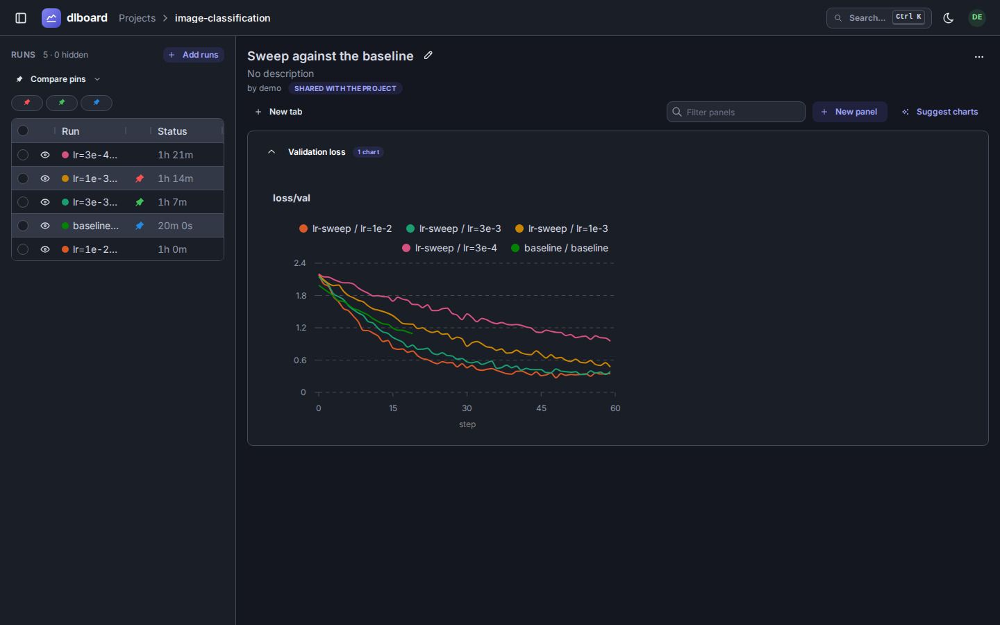

# Runs, pins and comparisons

Every page of a project has a list of runs in its sidebar: an experiment's runs, the runs of a comparison, or the project's
pinned runs. They work the same way on all three, so what you learn on one is what you do on the others.

## The run list

- **The eye** draws a run in the charts, or takes it out of them. On an experiment it is saved with the view (a view
  remembers which runs it draws); on a comparison it is yours alone, in the address bar, and saves nothing.
- **The checkbox** only selects a run. Once something is selected, a bar above the list says how many and offers what can be
  done to them: **Show** or **Hide** them, **Diff** them (the A/B comparison, for up to five), **Pin** or **Unpin** them,
  **Compare** them (below) and **Delete** them (asking first, and saying how many); on a comparison **Remove** takes them out
  of it. The checkbox in the header selects the runs the list's filters match, not every run of a long experiment.
- **A run's name** is a link to the run: its experiment with only that run drawn, and a banner that says so and
  links back to the view's own runs. Like the tab you are on, it is yours alone and saves nothing.
- **The experiment's name**, in the breadcrumb, is a menu of the project's experiments to switch to.

## Pins

A pin flags a run, and says who flagged it. It is project-wide: everyone who can see the run sees its pins. A run can be
pinned the moment it exists, whether or not it has logged anything yet.

- **Colours.** A pin is plain or one of nine colours, so a team can keep its own set apart from another's: red for one team's
  candidates, green for the runs under review. A colour is always shown as a pin in that colour, never by its name. You can
  pin a run in as many colours as you like, once each.
- **A run's pins are one pin**, filled with all its colours (a wheel of them, if there are several). Hover it to see who
  pinned the run in each. Click it to pin the run in other colours, or take your own pin back: another person's pin is theirs
  to take back.
- **Pin a selection** with the bar's **Pin** and **Unpin**: every selected run, in one colour.
- **Find a pinned run** with the chips above an experiment's list (one for each colour something in it is pinned in), which
  show only the runs pinned in the colours you pick, however far down the list they are.
- **The project page** lists the project's pinned runs in its sidebar: a row for each run, however many pins it has,
  paged, and filtered by colour, who pinned it, experiment and name. The filters and the page are in the address bar, so
  "Alice's red pins in this experiment" is a link you can send.

## Comparisons

A comparison is a page of charts, like an experiment's, over a list of runs you chose from any experiments of a project. It
belongs to whoever made it, and can be shared with the project. A project's comparisons are cards on its page.

- **Start one from an experiment or a project.** On its run list, **Compare** has **New comparison** (from the selected runs)
  and **Add to** (the comparisons you may add to, the first few). A new one starts with the panels and columns of
  the page it is made on, never its run selection. Either takes you to the comparison.
- **On a comparison you may change, runs are added to it, not to a new one.** There **Compare** reads **Add to this comparison**,
  and **Compare pins** reads "Add red pins to this comparison". The comparison stays where it is, with its panels and its URL, and
  its run list is drawn again with the runs added. A view is not forked by a change to the runs it shows.
- **Compare what is pinned.** **Compare pins** lists each colour something is pinned in, with how many runs it holds, and
  compares every one of them, whoever pinned it. Pin a run in each of two experiments and compare them in two menus. Comparing the same runs again from an experiment or project opens the comparison you already made of them, rather than another copy.
- **Add runs** on the comparison itself, if you may: every run of the project pinned in the colours you pick (it says how
  many that adds first), or runs searched in one experiment. Runs are labelled "experiment / run" in every legend, since two
  experiments can each have a run called `fluffy-otter`.
- **Take runs out** (select them, then **Remove**) or add them, if you may: the runs of a *shared* comparison are any editor's
  to add and take out, so a team can keep one list up to date, and a private comparison's are its owner's. Anyone else is not
  offered the buttons.
- **Who can change what else.** A comparison's charts and settings stay its owner's: editing them as anyone else saves a copy
  of your own (which keeps what you had hidden), as editing someone else's saved view does.

A comparison holds at most `DLBOARD_MAX_COMPARISON_RUNS` runs (100 by default), however it was filled: starting or adding to
one that would hold more is refused, with how many fit. A run that was deleted still counts until it is purged. Its list shows
the columns it started with (hyperparameters, and the latest value of each metric), since across
experiments the config is often what tells two runs of the same name apart. It has no **Columns** picker of its own yet, so
choose the columns on the experiment before you start the comparison from it.

### What a comparison costs

A comparison reads each experiment it draws from separately, on the same indexes as an experiment page, so what it reads is
that of the runs it holds and not of how much else the project has logged. It does read each experiment on its own, though: a
comparison of runs from 30 experiments makes about 30 times the reads of one experiment's page for the same charts (measured
on Postgres with 100 runs and six line charts: 13 queries and a third of a second in one experiment, 391 queries and under
three seconds across 30). Keep a comparison to the few experiments you are really comparing. The columns a key picker offers
are kept per experiment until it changes, so searching them costs a lookup of each experiment rather than a listing of its
keys.

The metrics that suggested charts and auto-populate offer are those the *experiments* of a comparison's runs logged, not only
the comparison's own runs, so a comparison of one run of a big sweep is offered charts of keys that run never logged, and they
draw empty.

Not yet: live updates and the A/B diff on a comparison page (reload to see new data).
