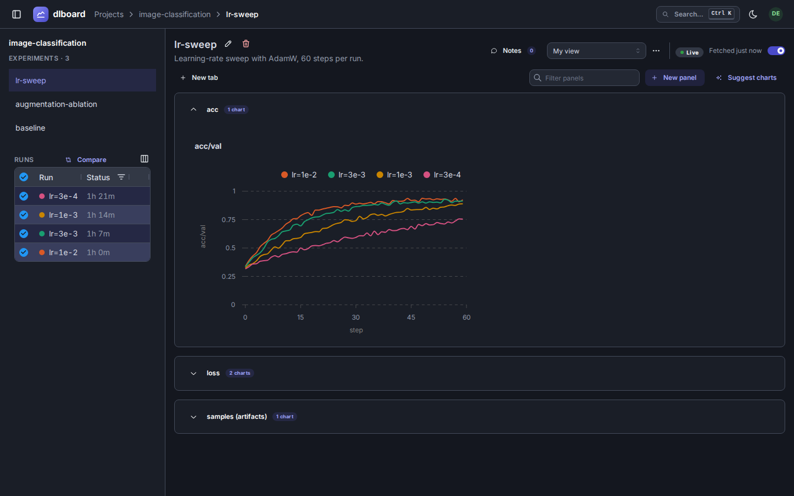
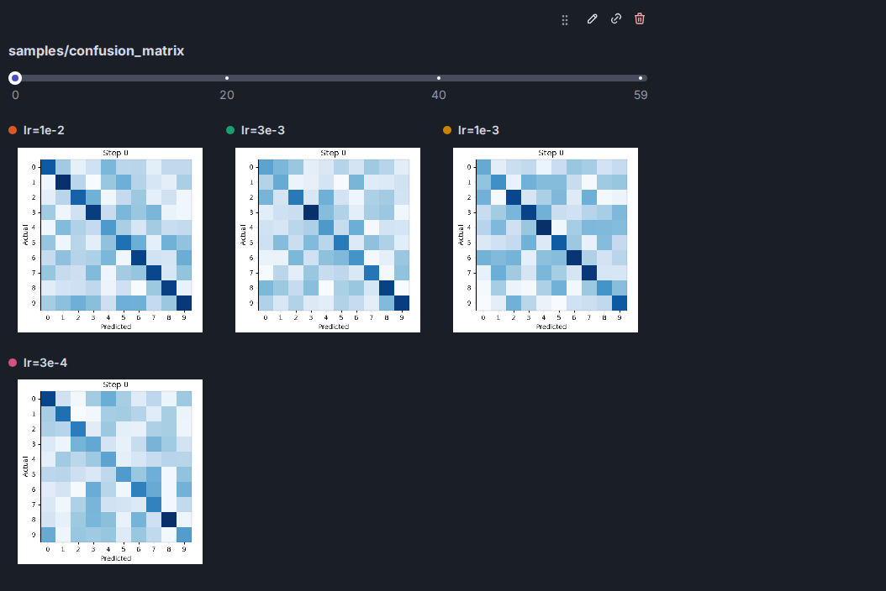
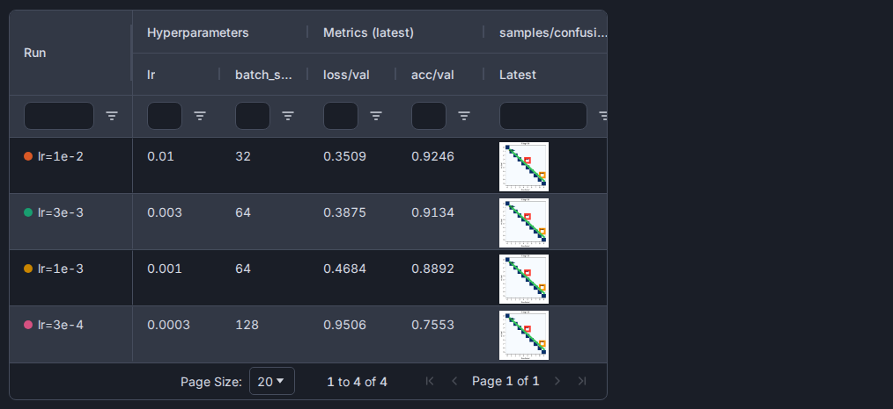
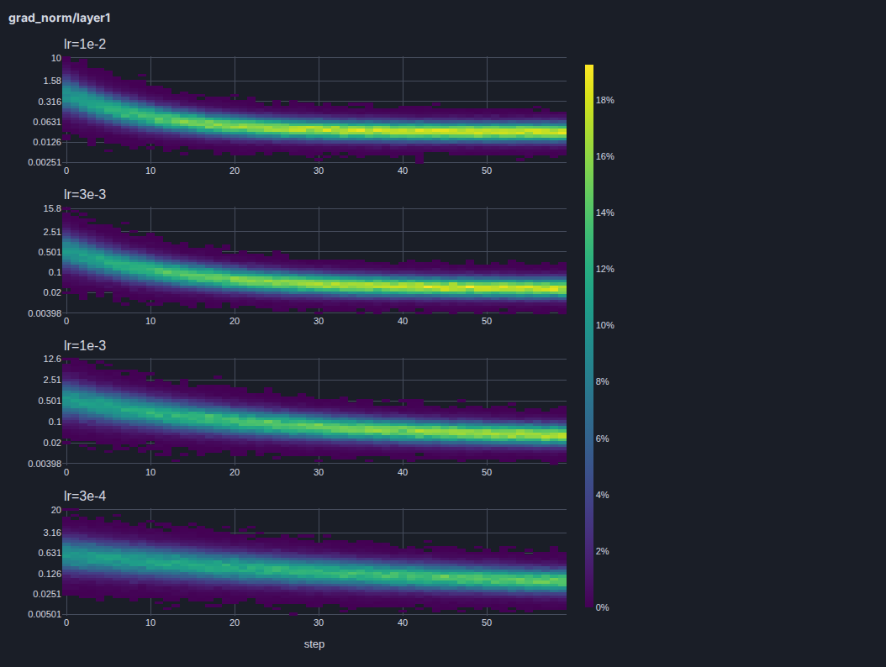

# Chart plugins

## What is this

A chart plugin defines one `ChartType` — a way to turn parameters and a dataframe of logged data
into a rendered Dash component. `ChartType[P, D, C]` (`dlboard/models/_view.py`) is generic over
its parameter model `P`, the data shape it renders from `D`, and the rendered component type `C`.
Built-ins: `line_chart.py`, `bar_chart.py`, `table_chart.py`, `image_series.py`, `file_list.py`,
`histogram.py` (`dlboard/plugins/charts/`). `file_list.py` is what an artifact a browser can't show inline gets (a
checkpoint, say): its files by run and step, each with a download link. It is paged and sortable, and
splits files into tabs by what they are -- for the checkpoints `DLBoardLogger` uploads, `Latest`, `Best`
and `Top-k`, read from the `tag` and `score` tags the logger records. Set `key_prefix` (say
`checkpoints/`) instead of `key` and one chart lists every key under it, so a run's hundreds of
checkpoints (one key apiece) are one list, and Auto-generate makes exactly that.

`histogram.py` charts a logged histogram (see [Client & logging](../client.md): values binned in your training
process, so only buckets are sent) as it changes over steps -- per-layer gradient norms or weights, a distribution
of per-sample losses -- without averaging it away. A `display` setting picks the view: **heatmap** (the default;
step across, value bucket up, shaded by the share of that step's values in the bucket, in a `colorscale` of your
choice), **bands** (the median with the middle `band_share` of the values -- 0.68 by default -- and the min-max
around it, per step) or **step** (the distribution at one step as bars, with a slider to move through the steps).
Each is one figure with a row per run, labelled with the run's name and the color it has everywhere else, and a
panel's charts-per-page limits how many rows: the most recent runs are shown. `normalize` (on by default) shades
each step as a share of its own values so steps that logged different numbers of values compare; turn it off for raw
counts.

Whatever was logged, a chart is cheap to open, and each bound is a setting. It reads about
`DLBOARD_MAX_HISTOGRAM_STEPS` (256) steps per run: the store thins a longer run to every 2ⁿ-th step from its first
(keeping its latest too) before anything is read back, so a run that trained for a million steps costs the same to
open as one that trained for a thousand, and the steps shown stay put as it trains rather than shifting on every
refresh. It draws at most `max_rows` (128) value buckets per run, merging a finer lattice, and the step view's
slider moves through at most `max_slider_steps` (300) of them. The accent color of the bands and bars, the space
between rows, the ticks named on a value axis and the default shape are `DLBOARD_HISTOGRAM_*` settings, listed in
[Configuration](../configuration.md). Auto-generate makes a heatmap for each histogram key.

`table_chart.py` is a data table. Two settings shape it: what a **row** is (`rows`), and which **columns** it
shows (`show_metrics`, `show_hparams`, `show_artifacts`).

- `rows: run` (the default) is a row per run: its hyperparameters beside the latest value of each metric --
  each metric's own latest, as in the Runs table, not whatever was logged at the run's last step -- and its
  latest artifact under each key shown, with the tags. `aggregate` swaps "latest" for the first, minimum,
  maximum or mean of a metric.
- `rows: field` is a row for each value of a metric, `row_field` (`step`, `epoch`, ...). By default each run
  has its own rows; with `spread_by_run` the runs sit side by side, a column group each, which is how to
  compare a metric across runs. Anything a run logged between two values of the row field belongs to the
  earlier, so `rows: field`, `row_field: epoch`, `spread_by_run` and `show_artifacts: [samples/*]` is a row per
  epoch with each run's latest image of that epoch.
- `rows: artifact` is a row per logged artifact, beside what its run logged at that step, with each tag a
  column that sorts and filters as the number or text it is: the way to find a sample among hundreds.

Each `show_*` list takes names, or a prefix and a `*` for everything under it: `eval/*` is a column for every
key starting `eval/`, including ones logged later, and `*` alone is all of them. The metrics and hyperparameters
start at `*`; an empty list shows none, so a table of only artifacts is one. An image is a thumbnail linking to
the full one; any other file is a download link. Runs are named and colored as in the charts and the Runs
table, every column filters in place, and a table keeps its sort, filters and page when a live update
redraws it. A table saved with the earlier `mode` settings (`runs`, `pivot`, `artifacts`) opens as the rows
and columns that show the same table.

The built-in line charts, and the image series that steps through logged images:





An image series can draw layers over each picture. Its `overlays` setting is a row per artifact key, bottom layer first,
each with an `opacity` from 0 to 1. A layer is an `Overlay` of shapes (see [docs/client.md](../client.md)) or any image,
such as a segmentation mask, and the one the run logged at each picture's own step is laid over it, in its thumbnail and
in its enlarged view. A picture a layer has nothing for at its step is shown without it. Auto-generate adds the
`_$overlay` artifacts of an image (`sample_$overlay`, or one per `name` after it: `sample_$overlay/truth`), if it
has any, and gives them no chart of their own. While the picture for the slider's
step is still downloading, its thumbnail shows a spinner over the previous picture.

A table of runs, with an artifact column:



A histogram chart's heatmap, one row per run (here the gradient norms of a layer shrinking and tightening as
four runs converge):



## When you'd need this

You want a new way to visualize logged metrics/artifacts that the built-in line/bar/table/image/histogram
charts don't cover — a scatter plot, a confusion matrix, anything with its own
parameter shape and rendering.

## How do I build one

Subclass `ChartType` and implement its abstract methods:

- `name: ClassVar[str]` — the registry key. Must be unique (see below).
- `parameter_type() -> type[P]` — the Pydantic model describing this chart's settings.
- `render(parameters, dataframe) -> C` — turn one instance into a Dash component.
- `hint_required_columns` / `hint_required_artifact_keys` / `hint_required_hparams` — tell the
  chart-autogen logic (`dlboard/serve/_pages/_experiment/_chart_autogen.py`) what a logged run
  needs before this chart type is even offered.
- `hint_required_artifact_key_prefixes` (optional, none by default) — for a chart that lists a whole
  family of artifacts (every `checkpoints/...` key) rather than named ones: every key starting with one of
  these is fetched, including keys logged later.
- `hint_required_histogram_keys` (optional, none by default) — the logged histogram keys the chart shows. A
  chart always names them: there is no "every histogram", because a histogram is the most expensive thing a panel
  fetches. A field naming one is a `ColumnKind.HISTOGRAM` in `field_column_kinds()`.

The same hints bound what the experiment page fetches: a panel shows one page of its charts, and only
those charts' columns and keys are requested. They are also what the panel's chart filter matches
against (a fuzzy match on each metric and artifact key, and on the chart type), so a chart type that hints
accurately is both cheap to page and easy to find. A chart whose hint is `None` ("everything") is found by
its chart type alone.
- `field_column_kinds()` — map each parameter field to the `ColumnKind` (metric/artifact/hparam)
  that populates it, so the settings UI knows what to offer as choices.
- `can_display_artifact(artifact) -> bool` (optional, `False` by default) — say which logged artifacts this
  chart type can display. Auto-generating and suggesting charts give an artifact key the first built-in
  chart type that says yes; an artifact no chart type claims simply gets no generated chart.

`plug(app)` registers the class and, if the chart needs its own clientside JS (a tooltip
formatter, say), serves it from a route this plugin owns:

```python
def plug(app: Dash) -> None:
    MyChart.register(allow_override=True)
    # optional, for chart-local JS: served from this app only, cached forever under a content hash
    serve_asset(app, AssetKind.SCRIPT, _JS_PATH.name, _JS_PATH.read_bytes())
```

Always pass `allow_override=True` — the composed app can get built more than once in a process
(tests do this legitimately), and `ChartTypeRegistry.register` raises on a second registration of
the same name unless told it's expected. `line_chart.py`/`bar_chart.py`/`table_chart.py`/
`image_series.py` are all consistent about this; follow their lead.

If your chart needs its own browser-side JS, keep the `.js` file next to the chart module and
serve/register it from `plug()` yourself, the way `bar_chart.py`/`line_chart.py` do for their
tooltip formatters — never drop it in a shared `assets/` folder or use Dash's global
`hooks.route`/`hooks.script` registry, both of which leak across every `Dash` app built in the same
process, not just the one that owns the file.

`bar_chart.py` is a good mid-sized reference: one settings model, one JS tooltip asset, grouping
logic shared from `_grouping.py`.
