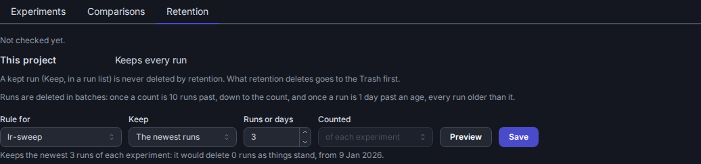

# Retention

A deployment that people log to for months grows without bound unless something deletes old runs. Retention does: each
project keeps a number of runs, or runs of a certain age, and a background task moves the rest to the Trash, which then
empties itself of what has been in it long enough.

## Rules

A project has one rule, set in the **Retention** tab of its page:

- **Every run**: nothing is deleted. A project that existed before retention keeps this until an admin sets a default.
- **The newest runs**: keep the newest N runs **of each experiment**, or N **of the whole project** together.
- **Runs newer than**: keep the runs created in the last N days.

An experiment may have a stricter rule of its own, of the same kind: fewer runs, or fewer days. Its project's rule is the
most it can keep. A project that keeps every run lets its experiments choose any kind. Every experiment's page says under
its header which rule its runs are kept by, its own (or "Follows the project") and its project's, and links to the
project's Retention tab, where both are set.

Changing the *kind* of a project's rule (from a count to an age, say) drops every one of its experiments' rules: a number of
runs says nothing about a number of days.

Who sets what:

| | Can |
|---|---|
| owner | set the project's rule, cancel its pending change |
| editor | set (or cancel) an experiment's rule |
| viewer | see the rules and how the project stands |

An admin can do all of it, in every project.

## When a rule takes effect

A changed rule waits `DLBOARD_RETENTION_GRACE_DAYS` (7) before it takes effect, and the tab shows it as pending, with
the date. **Preview** counts how many runs the form's rule would delete as things stand (a count of every experiment, so it
is asked for rather than shown as you type). Until the rule takes effect **the rule before it is still enforced**: saving
again replaces the pending change, but never puts retention off, and the server sets when it takes effect, whatever a
request says. Saving the rule in effect again, or **Cancel pending change** (for the project or experiment the form is set
to), drops the pending change.

A project with no rule of its own (a new one, or one from before retention) is given the server's default (below) the next
time [scheduling](#how-it-runs) runs, through the grace period like any other change: until then it keeps every run.

## What is deleted

Retention deletes in batches, not one run for each new one. A count acts once a project or experiment holds
`DLBOARD_RETENTION_RUN_SLACK` (10) runs past it, and then deletes down to the count; an age acts once a run is
`DLBOARD_RETENTION_AGE_SLACK_DAYS` (1) past it, and then deletes every run older than the age. The oldest go first.

Never deleted by retention:

- **A kept run.** Select runs in any run list and click **Keep** in the bar: a lock after a run's name says it is kept. A
  kept run is not counted either, so keeping runs never makes retention delete others. An editor keeps a run; only an owner
  (or an admin) releases it (**Release**) or deletes it, and deleting an experiment that holds a kept run is an owner's too.
  A script that knows its run matters (a baseline, a release candidate) keeps it as it launches it:
  `DLBoardLogger(..., keep=True)`, see [client.md](client.md#how-it-works). Keeping is not pinning: anyone can
  pin a run, which flags it for a comparison and nothing more.
- **A run still running**, for `DLBOARD_RETENTION_RUNNING_GRACE_DAYS` (7). A run that has been running for longer than that
  has lost its client (a training process that died never says it ended) and is deleted as any other.

What retention deletes goes to the **Trash**, as a run you delete does, and can be restored from the admin page until it is
purged. The audit log names the retention user (`dlboard:retention`) as who deleted it.

## The Trash

Anything that has been in the Trash `DLBOARD_TRASH_RETENTION_DAYS` (30) is purged for good, with its artifacts' files,
whoever deleted it. The 30 days count from no earlier than the first time the server checks, so upgrading never purges what
was already in the Trash the moment it starts. The purge is queued as the `dlboard:trash` user and done by the custodian like
any admin's purge.

A purge deletes the rows that can number in the millions (a run's metrics, histograms and artifacts) a chunk at a time, each
in a transaction of its own, resting between chunks like the custodian's other work, so that one very large run never holds the
database for as long as it is big. On SQLite, which lets one writer in at a time, deleting twenty million metrics in one
transaction took a minute and turned away every other writer meanwhile (a run logging beside it failed with `database is
locked`); in chunks, the longest anyone else waited was under 0.4 seconds, for twenty million metrics or half a million
artifacts. A purge that is interrupted (the server stopping, say) goes on where it was. Restoring a run while its purge goes on
stops the purge, but not what it had already deleted: the run comes back without those rows, so restore from the Trash before
a purge is asked for, not after. Deleting a run (moving it to the Trash) was never the slow part: it stamps the run and its
artifacts, and never touches its metrics.

## How it runs

Retention is two [background tasks](background-tasks.md), run by the custodian process, never by a web worker:

1. **Scheduling**, every `DLBOARD_RETENTION_INTERVAL_S` (300), gives a project from before retention the server's default
   (and lowers one past a lowered cap), both through the grace period like any change, and queues one check for every project
   held to a rule. One read gives every project's rule, so a project that has none (and has no default to be given) is not
   looked at again, and a project costs a statement only when its rule changes. A check queued twice is queued once.
2. **Checking** is shared: every custodian claims a project at a time, so several servers, or a server with a lot to catch up
   on, check different projects at once. A check works out once where each experiment's rule cuts it (a probe or two for each
   experiment, so that costs the number of experiments, not of runs), then reads what is past the cut and deletes
   `DLBOARD_RETENTION_BATCH` (100) at a time. It never deletes a run that was kept a moment before (the delete statement itself
   checks), counts what is left in the database rather than reading it, and pauses between batches so live traffic gets the
   database back (`DLBOARD_CUSTODIAN_DUTY_CYCLE`). One check deletes at most `DLBOARD_RETENTION_PROJECT_BUDGET` (5,000) runs before moving
   on, so one project far past a much stricter rule cannot hold up the others; it is caught up over several checks.

Until a project is caught up, its page says how many runs it still holds to delete, and after
`DLBOARD_RETENTION_WARN_AFTER_HOURS` (24) it warns that the project is out of spec. The Background tasks tab of the admin page
shows both tasks and their backlog, and `/healthz/custodian` goes red if they stop. Raise the budget, or run another server,
if a project stays behind. With the custodian off (`DLBOARD_CUSTODIAN_ENABLED=false`) and no other server sharing the
database, rules are kept and shown and nothing is deleted.

## When a project falls behind

A project holding runs its rule says to delete (a backlog, or a rule far stricter than what it held) is flagged on its page
after `DLBOARD_RETENTION_WARN_AFTER_HOURS` (24). That is all that happens by default. A deployment that must stay bounded can
go further: with `DLBOARD_RETENTION_LOCK_AFTER_HOURS` set (at least the warning's), a project that has been behind for that
long **takes no new runs**. The REST API answers a new run with HTTP 423 and says why, so the logging script fails at the
start rather than part-way, and a client never retries it. Nothing already logging is touched: a run that exists goes on
logging its metrics and artifacts, so no training job dies mid-epoch. The page says the project is locked, and it unlocks
itself on the first check that finds nothing left to delete, so a backlog being drained is not also being refilled.
`dlboard.retention.runs.refused` counts what a lock turned away.

## For admins: defaults and caps

| Variable | |
|---|---|
| `DLBOARD_RETENTION_DEFAULT_MAX_RUNS`, `DLBOARD_RETENTION_DEFAULT_UNIT` | A new project keeps this many runs of each experiment (or of the project). |
| `DLBOARD_RETENTION_DEFAULT_MAX_AGE_DAYS` | A new project keeps runs this many days old. Not with the one above. |
| `DLBOARD_RETENTION_MAX_RUNS`, `DLBOARD_RETENTION_MAX_AGE_DAYS` | The most an owner may keep. With a cap set, an owner can no longer keep every run, nor choose a kind of rule that has no cap; only an admin goes past it, and the rule says that one did. |

A project that existed before retention gets the default the first time the scheduling task runs, after the grace period
like any change. Lowering a cap does the same to every project past it, except one an admin set past it on purpose. Changing
the default later changes no existing project: each keeps the rule it has.

The counted runs are a project's own, so a cap of 1,000 runs is per experiment: a project of ten experiments can keep
10,000. Every variable is in [configuration.md](configuration.md#retention); the metric (`dlboard.retention.runs.deleted`) is
in [telemetry.md](telemetry.md#metrics).

## For plugin authors

Retention is a plugin (`dlboard/plugins/retention/`), built on what any plugin may use rather than anything of its own in the
core: a project's [scoped settings](background-tasks.md#plugin-settings-and-page-sections) hold its rules and status, the
generic `get_runs` filters (`created_before`, `oldest_first`, `include_kept`) choose what to delete, `delete_runs` deletes it,
and a tab of the project page shows it. A policy of your own (archiving to cold storage instead of deleting, a different rule
kind) is a plugin on the same pieces.
